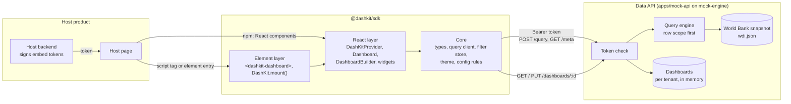
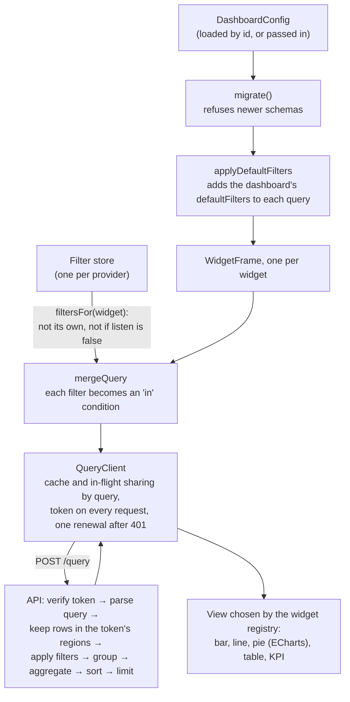
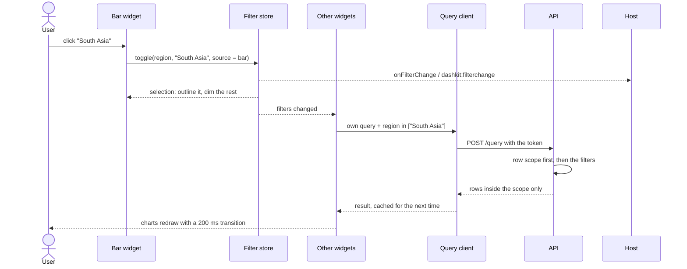
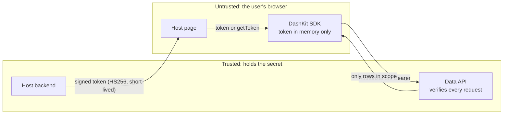
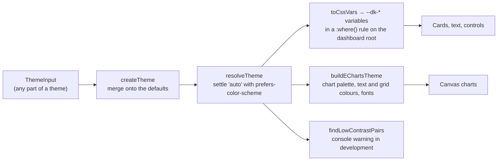
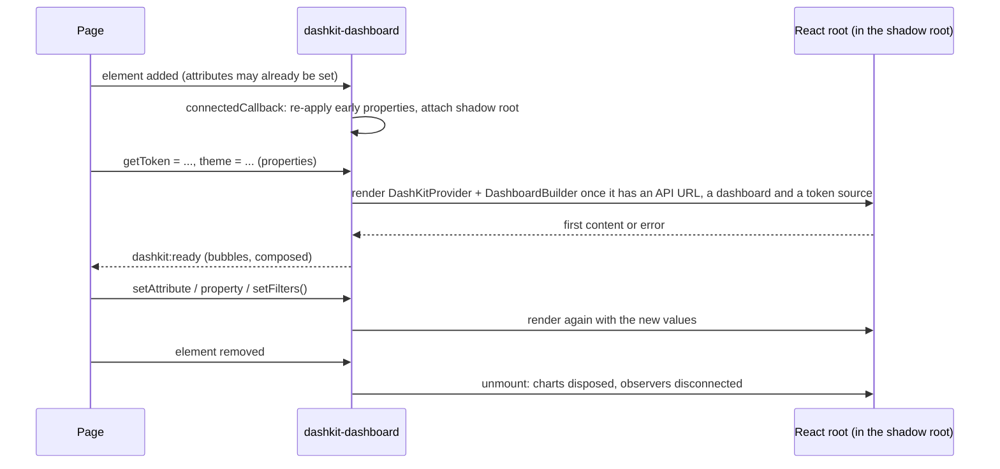

# Architecture

DashKit is one SDK with two ways in, one data API, and one JSON format for dashboards. This page
shows how the parts fit together, where the trust boundaries are, and why it is built this way.
The decisions behind each phase, with the alternatives considered, are in
[DECISIONS.md](DECISIONS.md).

## The system at a glance

The same API code runs in three places: as a Node server for the demo app, and through Mock
Service Worker inside Storybook and the unit tests. `packages/mock-engine` holds it as one
fetch-style function, `handle(Request) → Response`, so all three behave the same.

## Repository

| Folder                   | What it is                                                                                                                                  |
| ------------------------ | ------------------------------------------------------------------------------------------------------------------------------------------- |
| `packages/sdk`           | The SDK: source, both builds, Storybook, unit and component tests.                                                                          |
| `packages/mock-engine`   | The data API as a library: token signing and checks, query parsing and execution, dashboards, the data snapshot, the demo users and brands. |
| `packages/react18-check` | Runs the SDK's component tests again against React 18.                                                                                      |
| `apps/mock-api`          | A Node HTTP server around mock-engine, with CORS.                                                                                           |
| `apps/demo`              | The demo host: a React app with user, brand and mode switches, and a plain HTML page using the script tag.                                  |
| `e2e`, `perf`            | Playwright tests across Chromium, Firefox and WebKit, and the performance measurements.                                                     |
| `scripts`                | The World Bank fetch, and the check that installs the packed SDK into fresh projects.                                                       |

## The SDK's three layers

| Layer   | Folder        | Contents                                                                                                                                                                            | Must not know about |
| ------- | ------------- | ----------------------------------------------------------------------------------------------------------------------------------------------------------------------------------- | ------------------- |
| Core    | `src/core`    | Public types, the query client, the filter store, query merging, theme creation and contrast checks, config migration, validation, edits and layouts, number formats, render timing | React, the DOM      |
| React   | `src/react`   | The provider, dashboard, builder, grid, filter bar, widget frame and views, chart options and ECharts theme, styles                                                                 | Custom elements     |
| Element | `src/element` | `<dashkit-dashboard>`, its shadow root and host styles, `DashKit.mount()`                                                                                                           | Business logic      |

Dependencies point one way: element → React → core. No lint rule enforces it; no file in
`src/core` imports React, and nothing in `src/react` imports the element layer.

Two builds come from the same source:

| Build      | Entry            | Output                                                             | Contents                                                                                                       |
| ---------- | ---------------- | ------------------------------------------------------------------ | -------------------------------------------------------------------------------------------------------------- |
| npm        | `src/index.ts`   | `dist/index.js` (ES module) and `dist/index.d.ts`                  | The SDK's own code. React, React DOM, ECharts and react-grid-layout stay imports, so a host shares its copies. |
| Script tag | `src/element.ts` | `dist/dashkit.js` (IIFE, `window.DashKit`) and `dist/element.d.ts` | Everything, React included. `import '@dashkit/sdk/element'` loads the same file.                               |

## How a widget gets its data

- **One path to the network.** Widgets declare a `Query`; only the query client sends requests. It
  attaches the token, shares identical queries that are in flight, caches results until the token
  changes, and turns every failure into a `DashKitError`. Ten widgets with five distinct queries
  send five requests.
- **Chart options are pure functions.** `buildBarOption`, `buildLineOption` and `buildPieOption`
  turn a `QueryResult`, the widget config and the selection into an ECharts option, and are tested
  without a canvas. ECharts is imported module by module: three chart types, three components and
  the canvas renderer.
- **The registry** lists, for each widget type, its view, its minimum size in the builder and the
  settings its panel shows, so the palette, the grid and the panel read one table.

## Cross-filtering

Widgets never talk to each other: they read and write the store. Because the API applies the row
scope before any filter, a filter can narrow what a user sees but never widen it, whether it comes
from a click or from the host. Each provider has its own store, so two dashboards on one page
filter independently.

## Trust boundaries

- The secret lives only with the host backend and the API. The SDK never signs and never holds a
  secret; the token stays in memory, never in `localStorage`, a cookie or a URL.
- The API takes the tenant, role and scopes from the verified token only. Dashboards are stored
  under the token's tenant, so another tenant's dashboard is simply not found.
- The SDK hides edit controls from viewers as a convenience; the API refuses their writes anyway.
- In the demo, `POST /auth/demo-token` plays the host backend. A real deployment has no such route.
  In Storybook the API runs inside the page with a random secret made at page load.

## Theme pipeline

Charts draw on a canvas, which cannot read CSS variables, so they get their colours from the
resolved theme directly. The CSS variables sit in a zero-specificity rule, so a React host can still
override one with ordinary CSS. The SDK's stylesheet travels as a string in a `<style>` element
beside the dashboard, so the same text works on a host page and inside a shadow root.

## The custom element

Inside the shadow root the dashboard root resets inherited properties with `all: initial`, so the
page's fonts and colours do not leak in. Fonts are the exception the host must handle: a shadow root
does not load `@font-face` rules, so the page loads any web font the theme names.

## Layout and the builder

- **Container breakpoints.** The dashboard measures its own width with a `ResizeObserver` and
  picks `lg` (12 columns, from 1200 px), `md` (8, from 900 px), `sm` (4, from 600 px) or `xs` (1).
  The same dashboard is one column in a sidebar and twelve on a wide page.
- **One stored layout.** Only `lg` is saved. Narrower layouts are derived from it by a pure
  function that keeps reading order, keeps minimum widths and ends each row flush.
- **Loaded, draft and saved.** The builder keeps a draft beside the loaded config, and after a save
  the stored copy, each tagged with the config it started from. When the loaded config changes, as
  when the user changes, stale drafts are ignored.
- **Edits are pure functions** from one config to the next, in `core/config`, tested without React.
  Save checks the draft with the same rules as the API and lists every problem at once.

## Measuring itself

The SDK writes User Timing entries: `dashkit:mount`, `dashkit:first-chart` (from mount to the
first chart's ECharts `finished` event), `dashkit:filter-change` and `dashkit:cross-filter` (until
every updated widget has drawn). The performance tests read them, and a host can too; see
[PERFORMANCE.md](PERFORMANCE.md).

## Decisions

The guide's starting decisions, and how each turned out:

| #   | Decision                                              | Why                                                                 | Rejected alternative            | As built                                                                                |
| --- | ----------------------------------------------------- | ------------------------------------------------------------------- | ------------------------------- | --------------------------------------------------------------------------------------- |
| D1  | A dashboard is one JSON document                      | The viewer renders it, the builder edits it, the API stores it      | Layout and widgets stored apart | As planned, with `schemaVersion` and `migrate()` for future formats                     |
| D2  | Widgets declare a `Query`; one query client runs them | One place for tokens, caching, sharing and filter merging           | Each widget calling `fetch`     | As planned; it also shares one token renewal between widgets                            |
| D3  | Row-level security on the server                      | Anything filtered in the browser is visible in the network panel    | Filtering in the browser        | As planned; row scope is applied before every filter                                    |
| D4  | One filter store per dashboard, through context       | Two dashboards on a page stay independent                           | A global store                  | One store per `DashKitProvider`; the host sets filters with its `filters` prop          |
| D5  | Theme tokens become `--dk-` CSS variables             | Works inside and outside a shadow root; hosts can override with CSS | CSS-in-JS at runtime            | As planned, except chart colours, which go straight to ECharts                          |
| D6  | ECharts, imported module by module                    | Click events, theming, resizing and accessibility built in          | D3, every chart by hand         | As planned; ECharts and its renderer are still 62% of the script build                  |
| D7  | Chart options from pure functions                     | Testable without a canvas                                           | Options built inside components | As planned                                                                              |
| D8  | The element wraps the React tree in a shadow root     | Style isolation and no framework needed                             | An iframe                       | As planned; a test adds hostile page CSS and finds no change beyond anti-aliasing noise |
| D9  | One query engine for the server and the browser mocks | Storybook and tests behave like the server, with no server          | Mocks that duplicate the logic  | As planned: the whole API, not only the engine, is shared                               |
| D10 | Layout follows the container's width                  | An embedded dashboard may sit in a narrow column                    | Viewport media queries          | As planned; only touch target sizes follow the pointer type                             |

Later decisions worth knowing when changing the code:

| Decision                                                           | Why                                                                                                                                                                           |
| ------------------------------------------------------------------ | ----------------------------------------------------------------------------------------------------------------------------------------------------------------------------- |
| `Dashboard` stays view-only; the builder is `DashboardBuilder`     | Hosts that never edit keep using `Dashboard` unchanged.                                                                                                                       |
| The element renders `DashboardBuilder`                             | Script-tag hosts get editing by setting `mode="edit"`; viewers still see only the dashboard.                                                                                  |
| Bar and pie widgets emit filters by default; line and table opt in | A widget filters by its first dimension. For the starter line chart that is the year, and the other widgets already show 2024 only, so a year filter would mostly empty them. |
| Keyboard users filter through each chart's data table              | Canvas charts have no focusable items; the table that covers the chart on focus gives every value a button.                                                                   |
| Charts animate for 200 ms, and not at all with reduced motion      | ECharts' default animations alone pushed a cross-filter past 300 ms.                                                                                                          |
| Several 401s at once share one token renewal                       | Every widget fails together when a token expires; the host's `getToken` should run once.                                                                                      |
| Column-level scope (FR-3.11) is not implemented                    | A stretch requirement; the claim exists in the token type and the API ignores it.                                                                                             |
