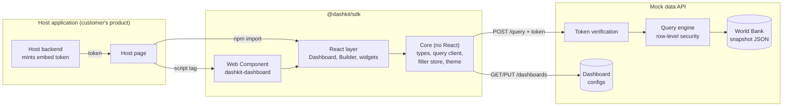
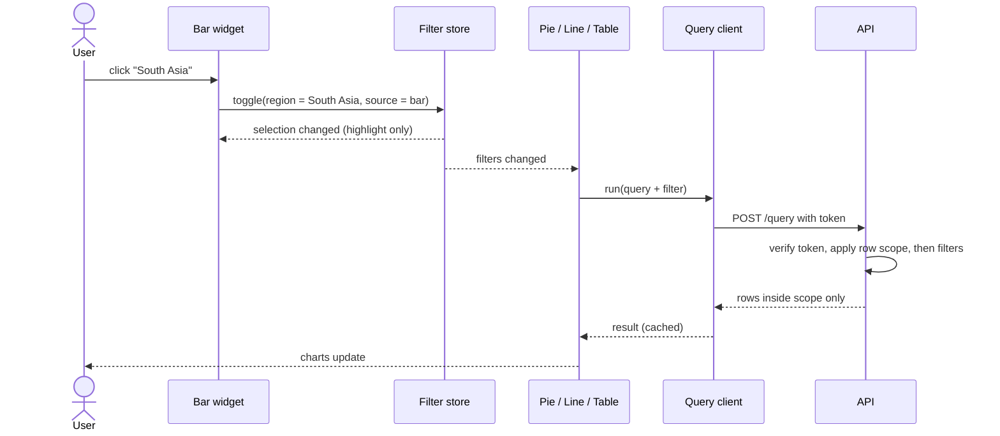
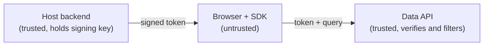

# DashKit — Implementation Guide

> **What this file is:** *how* to build everything listed in `PROJECT_REQUIREMENTS.md`.
> Requirement IDs such as `FR-3.4` refer to that file.
> Code blocks here are **design sketches** that show shape and intent. Always check the installed version of a library against its own documentation before copying an API call.

---

## Table of contents

1. [How to use this guide](#1-how-to-use-this-guide)
2. [Architecture](#2-architecture)
3. [Key design decisions](#3-key-design-decisions)
4. [Tooling and version notes](#4-tooling-and-version-notes)
5. [Repository structure](#5-repository-structure)
6. [Core contracts (TypeScript)](#6-core-contracts-typescript)
7. [HTTP API contract](#7-http-api-contract)
8. [Build phases](#8-build-phases)
9. [Embedding API (Web Component)](#9-embedding-api-web-component)
10. [Theming in depth](#10-theming-in-depth)
11. [Permission model in depth](#11-permission-model-in-depth)
12. [Cross-filtering in depth](#12-cross-filtering-in-depth)
13. [Builder in depth](#13-builder-in-depth)
14. [Responsive layout](#14-responsive-layout)
15. [Testing strategy](#15-testing-strategy)
16. [Measuring performance](#16-measuring-performance)
17. [Storybook plan](#17-storybook-plan)
18. [Deployment](#18-deployment)
19. [Documentation, presentation and reflection](#19-documentation-presentation-and-reflection)
20. [Troubleshooting](#20-troubleshooting)
21. [References](#21-references)

---

## 1. How to use this guide

- Work through the **phases in section 8 in order**. Each phase ends with a "done when" check. Do not start the next phase until the check passes.
- Sections 9–14 are deep dives. Each phase links to the one it needs.
- Commit after every numbered step. Small commits are a graded deliverable.
- Keep a running `docs/DECISIONS.md`. Every time you choose between two options, write two lines: what you chose and why. This becomes your presentation and reflection material.

---

## 2. Architecture

### 2.1 The system at a glance



### 2.2 The three layers of the SDK

| Layer | Folder | Knows about | Must not know about |
|---|---|---|---|
| **Core** | `src/core` | Types, HTTP, filter state, theme tokens, config validation | React, DOM rendering |
| **React** | `src/react` | Core, React, ECharts, the grid library | Custom elements |
| **Element** | `src/element` | React layer, Shadow DOM, attributes and events | Business logic |

Dependencies point one way only: Element → React → Core. This is what makes the SDK testable and lets one codebase produce both builds (FR-1.3).

### 2.3 What happens when a user clicks a bar



Two properties to notice, because the evaluator will ask about them:

1. Widgets **never talk to each other**. They only read and write the filter store.
2. The server applies the user's row scope **before** the user's filters. A filter can narrow data but can never widen it (FR-3.9).

---

## 3. Key design decisions

| # | Decision | Why | Alternative rejected |
|---|---|---|---|
| D1 | A dashboard is one JSON document (`DashboardConfig`) | Viewer renders it, builder edits it, API stores it. Save = store JSON | Storing layout and widgets separately |
| D2 | Widgets declare a `Query` object; a single `QueryClient` executes it | One choke point for tokens, caching, cancellation and filter merging | Each widget calling `fetch` |
| D3 | Row-level security lives on the server | Anything filtered in the browser is visible in the network tab | Client-side filtering |
| D4 | One store instance **per dashboard**, provided through context | Two dashboards on one page stay independent (FR-1.6) | A global singleton store |
| D5 | Theme = typed tokens → CSS custom properties with a `--dk-` prefix | Works in and out of Shadow DOM; hosts can override with plain CSS | CSS-in-JS runtime |
| D6 | ECharts, imported module by module | Click events, theming, resize and ARIA support built in; tree-shakable | D3 (every chart hand-built) |
| D7 | Chart options are produced by **pure functions** | Unit-testable without a canvas | Building options inside components |
| D8 | Web Component wraps the React tree inside a Shadow DOM | Style isolation and framework independence | iframe (heavier, harder to theme and resize) |
| D9 | The query engine is a pure function shared by the API server and by browser mocks | Storybook and tests run with no server and identical behaviour | Duplicating logic in mocks |
| D10 | Layout responds to container width | An embedded dashboard may sit in a narrow column of a wide page | Viewport media queries |

---

## 4. Tooling and version notes

Checked in November 2026. Install the latest stable release of each tool and read its documentation before use; these notes exist because older tutorials are now wrong in specific ways.

| Tool | What to know |
|---|---|
| **Vite** | Version 8 uses the Rolldown bundler. Bundler options live under `build.rolldownOptions`; the older `build.rollupOptions` name is a deprecated alias. Library mode is configured with `build.lib`. Needs a current Node LTS |
| **Storybook** | Current major is 10. Scaffold with `npm create storybook@latest` and let it detect Vite + React |
| **ECharts** | Version 6 added `chart.setTheme()` for switching themes without recreating the chart, and ships a new default look |
| **react-grid-layout** | Version 2 is a TypeScript rewrite with a hooks-based API and grouped config props (`gridConfig`, `dragConfig`, `resizeConfig`). The old flat-props API is available from `react-grid-layout/legacy`. Types are built in; do not install `@types/react-grid-layout`. Use the v2 API |
| **React** | Declare `react` and `react-dom` as peer dependencies covering 18 and 19 |
| **pnpm** | Used for the workspace (monorepo) |
| **Vitest / Testing Library / Playwright** | Unit, component and end-to-end tests |
| **MSW** | Mocks HTTP in the browser for Storybook and in Node for tests |
| **jose** | JWT signing and verification; runs in Node and browsers |

---

## 5. Repository structure

```
dashkit/
├─ package.json                 workspace scripts
├─ pnpm-workspace.yaml
├─ tsconfig.base.json           strict settings shared by all packages
├─ README.md
├─ docs/
│  ├─ PROJECT_REQUIREMENTS.md
│  ├─ IMPLEMENTATION_GUIDE.md
│  ├─ ARCHITECTURE.md
│  ├─ API.md
│  ├─ DECISIONS.md
│  ├─ TEST_REPORT.md
│  └─ PERFORMANCE.md
├─ packages/
│  ├─ sdk/                      → published as @dashkit/sdk
│  │  ├─ src/
│  │  │  ├─ core/
│  │  │  │  ├─ types.ts         all public types
│  │  │  │  ├─ query-client.ts  fetch, token, cache, dedupe, abort
│  │  │  │  ├─ filter-store.ts  cross-filter state
│  │  │  │  ├─ merge-query.ts   widget query + active filters
│  │  │  │  ├─ theme/           defaults, createTheme, toCssVars, contrast
│  │  │  │  ├─ config/          validate + migrate DashboardConfig
│  │  │  │  └─ layout.ts        derive small-screen layouts
│  │  │  ├─ react/
│  │  │  │  ├─ DashKitProvider.tsx
│  │  │  │  ├─ Dashboard.tsx
│  │  │  │  ├─ DashboardBuilder.tsx
│  │  │  │  ├─ hooks/           useWidgetData, useFilters, useEChart, useContainerWidth
│  │  │  │  ├─ widgets/         Bar, Line, Pie, Table, Kpi, WidgetFrame, registry
│  │  │  │  ├─ charts/          pure option builders + echarts theme builder
│  │  │  │  ├─ builder/         Palette, ConfigPanel, Toolbar
│  │  │  │  ├─ ui/              Button, Select, Chip, Skeleton, ErrorState
│  │  │  │  └─ styles/          *.css using --dk-* variables only
│  │  │  ├─ element/
│  │  │  │  ├─ dashkit-element.ts
│  │  │  │  └─ mount.ts         imperative DashKit.mount()
│  │  │  ├─ index.ts            npm entry (React API + types)
│  │  │  └─ element.ts          script-tag entry (registers the element)
│  │  ├─ .storybook/
│  │  ├─ vite.config.ts         npm build
│  │  ├─ vite.element.config.ts script-tag build
│  │  └─ package.json
│  └─ mock-engine/              pure TS, no Node APIs
│     ├─ src/
│     │  ├─ schema.ts           field whitelist, labels, default aggregations
│     │  ├─ execute-query.ts    scope → filter → group → aggregate → sort
│     │  ├─ auth.ts             sign / verify demo tokens
│     │  ├─ users.ts            demo tenants, users, scopes
│     │  └─ msw-handlers.ts     the same API, in the browser
│     └─ data/wdi.json          committed World Bank snapshot
├─ apps/
│  ├─ mock-api/                 thin HTTP server around mock-engine
│  └─ demo/                     fictional host product (React) + plain-html/index.html
├─ scripts/
│  └─ fetch-worldbank.ts        builds data/wdi.json
└─ e2e/                         Playwright tests
```

---

## 6. Core contracts (TypeScript)

Write these first, in `packages/sdk/src/core/types.ts`. Everything else is built against them.

### 6.1 Queries and results

```ts
export type Scalar = string | number | boolean | null;

export type DimensionField = 'country' | 'region' | 'incomeLevel' | 'year';

export type MeasureField =
  | 'gdp' | 'gdpPerCapita' | 'population' | 'lifeExpectancy'
  | 'internetUsers' | 'unemployment' | 'electricityAccess';

export type Aggregation = 'sum' | 'avg' | 'min' | 'max' | 'count';

export type FilterOperator =
  | 'eq' | 'neq' | 'in' | 'notIn' | 'gt' | 'gte' | 'lt' | 'lte' | 'between';

export interface Filter {
  field: DimensionField | MeasureField;
  op: FilterOperator;
  value: Scalar | Scalar[];
}

export interface Query {
  dataset: 'wdi';
  measures: { field: MeasureField; agg?: Aggregation; alias?: string }[];
  dimensions?: DimensionField[];
  filters?: Filter[];
  orderBy?: { field: string; direction: 'asc' | 'desc' }[];
  limit?: number;
}

export interface QueryResult {
  columns: {
    name: string;
    role: 'dimension' | 'measure';
    label: string;
    format?: 'number' | 'currency' | 'percent' | 'year';
  }[];
  rows: Record<string, Scalar>[];
  meta: { rowCount: number; truncated: boolean; durationMs: number };
}
```

### 6.2 Dashboards and widgets

```ts
export type WidgetType = 'bar' | 'line' | 'pie' | 'table' | 'kpi';
export type Breakpoint = 'lg' | 'md' | 'sm' | 'xs';

export interface LayoutItem {
  i: string;            // widget id
  x: number; y: number; w: number; h: number;
  minW?: number; minH?: number;
}

export interface WidgetConfig {
  id: string;
  type: WidgetType;
  title: string;
  description?: string;
  query: Query;
  options?: {
    orientation?: 'vertical' | 'horizontal';
    stacked?: boolean;
    showLegend?: boolean;
    donut?: boolean;
    pageSize?: number;
  };
  crossFilter?: {
    emit?: boolean;     // default true for bar and pie
    listen?: boolean;   // default true
  };
}

export interface DashboardConfig {
  id: string;
  schemaVersion: 1;
  title: string;
  description?: string;
  widgets: WidgetConfig[];
  layouts: { lg: LayoutItem[] } & Partial<Record<'md' | 'sm' | 'xs', LayoutItem[]>>;
  defaultFilters?: Filter[];
  updatedAt?: string;
  updatedBy?: string;
}
```

### 6.3 Theme

```ts
export interface ColorTokens {
  primary: string; primaryContrast: string;
  background: string; surface: string; surfaceRaised: string;
  text: string; textMuted: string; border: string;
  success: string; warning: string; danger: string;
  chart: string[];                      // categorical series palette, 6–10 colours
}

export interface DashKitTheme {
  mode: 'light' | 'dark' | 'auto';
  light: ColorTokens;
  dark: ColorTokens;
  typography: { fontFamily: string; headingFontFamily: string; baseFontSize: number };
  shape: { radius: number };            // px; 0 = square
  brand: { name?: string; logoUrl?: string; logoAlt?: string };
}

/** What integrators pass in. Every field is optional. */
export type ThemeInput = DeepPartial<DashKitTheme>;
```

### 6.4 Auth and SDK options

```ts
export interface TokenClaims {
  sub: string;                          // user id
  tenantId: string;
  role: 'viewer' | 'editor';
  scopes: {
    regions: string[] | '*';            // region codes the user may see
    measures?: MeasureField[] | '*';    // optional column-level scope
  };
  exp: number; iat: number;
}

export interface ActiveFilter {
  field: DimensionField;
  values: Scalar[];
  sourceWidgetId: string;
}

export interface DashKitError {
  code: 'UNAUTHENTICATED' | 'FORBIDDEN' | 'INVALID_QUERY' | 'NOT_FOUND' | 'NETWORK' | 'UNKNOWN';
  message: string;
}

export type DeepPartial<T> = { [K in keyof T]?: T[K] extends object ? DeepPartial<T[K]> : T[K] };

export interface DashKitOptions {
  apiUrl: string;
  token?: string;
  getToken?: () => Promise<string>;     // called on start and after a 401
  dashboardId?: string;                 // load config from the API…
  config?: DashboardConfig;             // …or supply it directly
  mode?: 'view' | 'edit';
  theme?: ThemeInput;
  onFilterChange?: (filters: ActiveFilter[]) => void;
  onSave?: (config: DashboardConfig) => void;
  onError?: (error: DashKitError) => void;
}
```

---

## 7. HTTP API contract

Base URL is configurable. All routes except `/health` and `/auth/demo-token` require `Authorization: Bearer <token>`.

| Method | Path | Purpose | Notes |
|---|---|---|---|
| GET | `/health` | Liveness check | |
| POST | `/auth/demo-token` | Returns a signed token for a demo user | **Stands in for the host's own backend.** Body: `{ "userId": "ravi" }` |
| GET | `/meta` | Fields the caller may use: dimensions, measures, labels, formats, default aggregations | Filtered by column scope |
| POST | `/query` | Runs a `Query`, returns a `QueryResult` | Row scope always applied |
| GET | `/dashboards` | Lists dashboards of the caller's tenant | |
| GET | `/dashboards/:id` | One dashboard config | 404 if not in caller's tenant |
| PUT | `/dashboards/:id` | Create or replace | `editor` role only |
| DELETE | `/dashboards/:id` | Delete | `editor` role only |

**Example request**

```http
POST /query
Authorization: Bearer eyJhbGciOi...
Content-Type: application/json

{
  "dataset": "wdi",
  "measures": [{ "field": "population", "agg": "sum" }],
  "dimensions": ["region"],
  "filters": [{ "field": "year", "op": "eq", "value": 2020 }],
  "orderBy": [{ "field": "population", "direction": "desc" }]
}
```

**Example response**

```json
{
  "columns": [
    { "name": "region", "role": "dimension", "label": "Region" },
    { "name": "population", "role": "measure", "label": "Population", "format": "number" }
  ],
  "rows": [
    { "region": "East Asia & Pacific", "population": 2360000000 },
    { "region": "South Asia", "population": 1880000000 }
  ],
  "meta": { "rowCount": 2, "truncated": false, "durationMs": 3 }
}
```

*(Values above are illustrative.)*

**Errors** always use one shape:

```json
{ "error": { "code": "UNAUTHENTICATED", "message": "Token expired" } }
```

| HTTP | Code | When |
|---|---|---|
| 400 | `INVALID_QUERY` | Unknown field, operator or aggregation; malformed body |
| 401 | `UNAUTHENTICATED` | Missing, malformed, badly signed or expired token |
| 403 | `FORBIDDEN` | Viewer attempting to save; measure outside column scope |
| 404 | `NOT_FOUND` | Dashboard does not exist **in the caller's tenant** |

---

## 8. Build phases

### Phase 0 — Foundation (day 1)

**Goal:** an empty but fully wired project where build, lint, typecheck, test and Storybook all run.

1. Create the pnpm workspace, `tsconfig.base.json` (`strict`, `noUncheckedIndexedAccess`, `exactOptionalPropertyTypes`), ESLint, Prettier, `.editorconfig`, `.gitignore`.
2. Scaffold `packages/sdk` and write `core/types.ts` from section 6.
3. Configure the two Vite builds:

   ```ts
   // vite.config.ts — npm build (sketch)
   export default defineConfig({
     plugins: [react(), dts({ rollupTypes: true })],
     build: {
       lib: { entry: 'src/index.ts', formats: ['es'], fileName: 'index' },
       rolldownOptions: {
         external: ['react', 'react-dom', 'react/jsx-runtime', /^echarts/, /^react-grid-layout/],
       },
     },
   });
   ```

   ```ts
   // vite.element.config.ts — script-tag build (sketch)
   export default defineConfig({
     plugins: [react()],
     define: { 'process.env.NODE_ENV': '"production"' },   // library mode does not set this for you
     build: {
       emptyOutDir: false,
       lib: { entry: 'src/element.ts', formats: ['iife'], name: 'DashKit', fileName: () => 'dashkit.js' },
       // no externals: React and ECharts are bundled in
     },
   });
   ```

4. Write `package.json` `exports` so types resolve:

   ```json
   {
     "name": "@dashkit/sdk",
     "type": "module",
     "exports": {
       ".": { "types": "./dist/index.d.ts", "import": "./dist/index.js" },
       "./styles.css": "./dist/styles.css",
       "./element": "./dist/dashkit.js"
     },
     "files": ["dist"],
     "sideEffects": ["**/*.css", "./dist/dashkit.js"],
     "peerDependencies": { "react": "^18 || ^19", "react-dom": "^18 || ^19" }
   }
   ```

5. **Risk spike (30 minutes, do not skip):** a throwaway custom element that attaches a shadow root and renders a React button with a click counter inside it. Load it from a plain HTML file. This proves the hardest integration on day 1.
6. Add Vitest, Storybook and a GitHub Actions workflow that runs install → lint → typecheck → test → build.

**Done when:** `pnpm build` emits `dist/index.js`, `dist/index.d.ts` and `dist/dashkit.js`; the spike works in a plain HTML page; CI is green.

**Commits:** `chore: init workspace`, `feat(core): add public type contracts`, `build(sdk): configure npm and element builds`, `ci: add checks workflow`.

---

### Phase 1 — Data and permissions (days 2–3)

**Goal:** a query API that returns different rows for different users. Deep dive: [section 11](#11-permission-model-in-depth).

1. **Fetch script** (`scripts/fetch-worldbank.ts`):
   - Country list: `GET https://api.worldbank.org/v2/country?format=json&per_page=400`. Each entry has a region and income level. Entries whose region is "Aggregates" are not countries; drop them.
   - Each indicator: `GET https://api.worldbank.org/v2/country/all/indicator/{CODE}?format=json&per_page=20000&date=2000:2024`. The response is a two-element array: paging metadata, then rows. Follow paging if `pages > 1`.
   - Pivot into one row per country-year, keep `null` for missing values, write `packages/mock-engine/data/wdi.json`, and log row and null counts.
   - Confirm the URL shapes against the World Bank API documentation before relying on them.
2. **Schema** (`schema.ts`): the single whitelist of dimensions and measures with labels, formats and default aggregations.
3. **`executeQuery(rows, query, claims)`** as a pure function, in this exact order:

   ```ts
   validate(query, schema);                         // 400 on anything not whitelisted
   assertMeasuresAllowed(query, claims.scopes);     // 403 on column scope violation
   const scoped   = rows.filter(r => inScope(r, claims.scopes));   // RLS — always first
   const filtered = scoped.filter(r => matchesAll(r, query.filters));
   const grouped  = groupBy(filtered, query.dimensions ?? []);
   const out      = aggregate(grouped, query.measures);            // nulls are skipped, never treated as 0
   return limit(sort(out, query.orderBy), query.limit ?? 1000);
   ```

4. **Auth** (`auth.ts`): `signDemoToken(userId)` and `verifyToken(token)` using HS256 with a secret from an environment variable; 15-minute expiry.
5. **HTTP server** (`apps/mock-api`): the routes in section 7, CORS for the demo and Storybook origins, the error shape, and an in-memory dashboard store keyed by `tenantId + id`, seeded with one starter dashboard per tenant.
6. **`QueryClient`** in the SDK:
   - attaches the token; on `401` calls `getToken()` once and retries;
   - caches results by a stable hash of the query;
   - **clears the whole cache whenever the token changes** (FR-3.10);
   - shares one in-flight promise between identical concurrent queries (NFR-P6);
   - accepts an `AbortSignal`.
7. **MSW handlers** that expose the same routes in the browser by calling the same engine functions.

**Done when:** a test matrix runs every demo user against a set of queries and asserts that no returned row lies outside that user's regions; tampered and expired tokens return 401; a viewer's `PUT` returns 403; tenant A gets 404 for tenant B's dashboard.

**Commits:** `feat(data): add World Bank fetch script and snapshot`, `feat(engine): add query execution with row-level security`, `feat(api): add auth, query and dashboard routes`, `feat(core): add query client with cache and token refresh`, `test(engine): add permission matrix`.

---

### Phase 2 — Widgets and theming (days 4–5)

**Goal:** five widgets rendering real data in any brand. Deep dive: [section 10](#10-theming-in-depth).

1. `createTheme(input)` → deep-merge with defaults → `resolveTheme(theme, systemPrefersDark)` → `toCssVars(resolved)`.
2. `DashKitProvider` creates one `QueryClient`, one filter store and the resolved theme, and exposes them through context.
3. Base UI in `react/ui` (Button, Select, Chip, Skeleton, ErrorState, EmptyState). CSS uses only `--dk-*` variables and `dk-` prefixed class names.
4. `useEChart(ref, option, echartsTheme, handlers)`:
   - registers only the modules used:

     ```ts
     import * as echarts from 'echarts/core';
     import { BarChart, LineChart, PieChart } from 'echarts/charts';
     import { GridComponent, TooltipComponent, LegendComponent, DatasetComponent, AriaComponent } from 'echarts/components';
     import { CanvasRenderer } from 'echarts/renderers';
     echarts.use([BarChart, LineChart, PieChart, GridComponent, TooltipComponent, LegendComponent, DatasetComponent, AriaComponent, CanvasRenderer]);
     ```

   - initialises once, calls `setOption` on change, resizes through a `ResizeObserver`, disposes on unmount;
   - switches theme with `setTheme()` where available.
5. Pure option builders: `buildBarOption(result, widget, tokens, selection)`, and the same for line and pie. No React inside them.
6. `WidgetFrame` (title, menu, loading/empty/error states) and a **widget registry** mapping `WidgetType` to component, default size and config fields.
7. `useWidgetData(widget)` returns `{ data, status, error, isFetching }` and keeps the previous data while refetching.
8. `Dashboard` renders a config in a static CSS grid for now.
9. Three brand themes in the demo app; a Storybook toolbar switch for brand and mode.

**Done when:** all five widgets show real data; switching between three brands and both modes changes every surface including charts; a search of the source for hex colours outside `theme/defaults.ts` returns nothing.

**Commits:** `feat(theme): add tokens, createTheme and CSS variables`, `feat(react): add provider and base UI`, `feat(charts): add option builders and echarts hook`, `feat(widgets): add bar, line, pie, table and kpi`, `docs(storybook): add widget and theme stories`.

---

### Phase 3 — Cross-filtering (days 6–7)

**Goal:** click a bar, everything else updates. Deep dive: [section 12](#12-cross-filtering-in-depth).

1. `createFilterStore()` with `toggle`, `remove`, `clearAll`, `set` and a `filtersFor(widgetId)` selector.
2. `mergeQuery(widget.query, activeFilters)`: pure function that appends active filters as `in` filters.
3. Wire `useWidgetData` to the store.
4. Chart click → `store.toggle(dimension, value, widgetId)`. Pass the selection into the option builder so the selected segment stays full-strength and the rest dim.
5. `FilterBar` with chips and "Clear all".
6. Stale-response protection: abort the previous request when the effective query changes.
7. Emit `onFilterChange`; accept filters from the host.

**Done when:** an end-to-end test clicks a bar and sees the pie, line and table change, then clicks again and sees them restored; a permission test shows a filter for a forbidden region returns zero rows.

**Commits:** `feat(core): add filter store and query merging`, `feat(widgets): emit and apply cross-filters`, `feat(react): add filter bar`, `test(e2e): cover cross-filter flow`.

---

### Phase 4 — Dashboard builder (days 8–10)

**Goal:** build, save and reload a dashboard without code. Deep dive: [section 13](#13-builder-in-depth).

1. Replace the static grid with react-grid-layout (v2 API); view mode has drag and resize disabled.
2. Builder state: a **draft** copy of the config, a dirty flag, and `selectedWidgetId`.
3. Toolbar: Edit, Save, Cancel. Palette: click to add a widget with defaults from the registry.
4. Widget chrome in edit mode: drag handle, configure, duplicate, delete.
5. `ConfigPanel` driven by the registry and `/meta`: title, type, measure, aggregation, dimension, sort, limit, cross-filter toggles. Live preview.
6. Save → validate → `PUT /dashboards/:id` → `onSave`. Cancel → restore the saved config.
7. Hide all edit affordances for viewers; the API also rejects their writes.
8. Unsaved-changes warning.
9. Stretch, only if ahead of schedule: undo/redo as a history stack of draft snapshots.

**Done when:** from an empty dashboard you can add four widgets, arrange and configure them, save, reload, and see the identical dashboard; a viewer sees no edit controls.

**Commits:** `feat(builder): add draggable resizable grid`, `feat(builder): add palette and widget actions`, `feat(builder): add config panel`, `feat(builder): persist dashboards`, `test(builder): cover save and reload`.

---

### Phase 5 — Embedding and responsive (day 11)

**Goal:** one script tag works anywhere; usable on a phone. Deep dives: [section 9](#9-embedding-api-web-component), [section 14](#14-responsive-layout).

1. Implement `<dashkit-dashboard>` and `DashKit.mount()`.
2. Inject every stylesheet (SDK styles **and** the grid library's styles) into the shadow root.
3. `apps/demo/plain-html/index.html`: nothing but a script tag, the element, and a few lines of vanilla JS.
4. Container-width breakpoints and derived small-screen layouts.
5. Touch-size audit; horizontal scroll for tables; builder falls back to view mode on narrow containers.
6. Verify installability: `pnpm pack` the SDK, install the tarball into a fresh project outside the workspace, import it, confirm types resolve.

**Done when:** the plain HTML page works with hostile host CSS present (for example `* { font-family: Comic Sans; } button { background: red; }`) and looks unchanged; the demo is usable at 360 px.

**Commits:** `feat(element): add dashkit-dashboard custom element`, `feat(element): add imperative mount API`, `feat(react): add container-based responsive layout`, `docs(demo): add plain HTML embedding example`.

---

### Phase 6 — Quality and documentation (days 12–13)

1. Fill test gaps ([section 15](#15-testing-strategy)); run an accessibility pass.
2. Measure and record performance ([section 16](#16-measuring-performance)).
3. Complete Storybook ([section 17](#17-storybook-plan)).
4. Write `README.md`, `docs/ARCHITECTURE.md`, `docs/API.md`, `docs/TEST_REPORT.md`, `docs/PERFORMANCE.md`.
5. JSDoc on every exported type and function.

**Done when:** a person who has never seen the repo can clone it and run the demo using only the README.

---

### Phase 7 — Ship (day 14)

1. Deploy API, demo and Storybook ([section 18](#18-deployment)).
2. Run the demo script from the requirements file against the deployed version.
3. Record the backup video.
4. Prepare slides and write the reflection ([section 19](#19-documentation-presentation-and-reflection)).

---

## 9. Embedding API (Web Component)

### 9.1 Public surface of `<dashkit-dashboard>`

| Kind | Name | Type | Purpose |
|---|---|---|---|
| Attribute | `api-url` | string | Base URL of the data API |
| Attribute | `dashboard-id` | string | Dashboard to load |
| Attribute | `token` | string | Embed token (simple cases) |
| Attribute | `mode` | `view` \| `edit` | Start mode |
| Attribute | `color-scheme` | `light` \| `dark` \| `auto` | Overrides `theme.mode` |
| Property | `theme` | `ThemeInput` | Full theme object |
| Property | `config` | `DashboardConfig` | Supply a dashboard directly |
| Property | `getToken` | `() => Promise<string>` | Token refresh callback |
| Method | `setFilters(filters)` | | Apply filters from the host |
| Method | `clearFilters()` | | |
| Method | `refresh()` | | Clear cache and refetch |
| Event | `dashkit:ready` | | First render complete |
| Event | `dashkit:filterchange` | `detail: ActiveFilter[]` | |
| Event | `dashkit:save` | `detail: DashboardConfig` | |
| Event | `dashkit:error` | `detail: { code, message }` | |

Rule of thumb: **strings go in attributes, objects and functions go in properties.**

### 9.2 Usage

```html
<script src="https://cdn.example.com/dashkit.js"></script>

<dashkit-dashboard
  api-url="https://api.example.com"
  dashboard-id="overview"
  color-scheme="auto">
</dashkit-dashboard>

<script>
  const el = document.querySelector('dashkit-dashboard');
  el.getToken = () => fetch('/my-backend/embed-token').then(r => r.text());
  el.theme = { light: { primary: '#4f46e5' }, shape: { radius: 12 } };
  el.addEventListener('dashkit:filterchange', e => console.log(e.detail));
</script>
```

### 9.3 Implementation sketch

```ts
class DashKitElement extends HTMLElement {
  static observedAttributes = ['api-url', 'dashboard-id', 'token', 'mode', 'color-scheme'];
  #root?: Root;
  #props: Partial<DashKitOptions> = {};

  connectedCallback() {
    this.#upgradeProperty('theme');                 // values set before the element was defined
    this.#upgradeProperty('config');
    this.#upgradeProperty('getToken');

    const shadow = this.shadowRoot ?? this.attachShadow({ mode: 'open' });
    const sheet = new CSSStyleSheet();
    sheet.replaceSync(allStyles);                   // SDK css + grid css, imported with ?inline
    shadow.adoptedStyleSheets = [sheet];

    const mount = document.createElement('div');
    mount.className = 'dk-root';
    shadow.replaceChildren(mount);
    this.#root = createRoot(mount);
    this.#render();
  }

  disconnectedCallback() { this.#root?.unmount(); this.#root = undefined; }
  attributeChangedCallback() { this.#render(); }

  set theme(value: ThemeInput) { this.#props.theme = value; this.#render(); }
  // …same pattern for config and getToken

  #emit(name: string, detail?: unknown) {
    this.dispatchEvent(new CustomEvent(name, { detail, bubbles: true, composed: true }));
  }
}

if (!customElements.get('dashkit-dashboard')) {
  customElements.define('dashkit-dashboard', DashKitElement);
}
```

### 9.4 Shadow DOM gotchas

| Gotcha | Fix |
|---|---|
| Stylesheets imported normally land in `document.head` and do not reach the shadow root | Import CSS as a string (`?inline`) and adopt it into the shadow root |
| The grid library's own CSS is also missing inside the shadow root | Include it in the same adopted stylesheet |
| `@font-face` rules declared inside a shadow root are not applied | Fonts must be loaded by the host page at document level. Document this for integrators |
| Events do not cross the shadow boundary by default | Dispatch with `composed: true` |
| Properties assigned before the script loads are lost | The "upgrade property" pattern shown above |
| Popovers and tooltips rendered into `document.body` lose styles | Render them inside the shadow root; keep ECharts tooltips confined to the chart container |
| Registering the element twice throws | Guard with `customElements.get` |
| Drag libraries attach listeners to `document` | Usually fine, because pointer events are composed. Test dragging inside the shadow root during Phase 0's spike or early in Phase 4 |

---

## 10. Theming in depth

### 10.1 Pipeline

```
ThemeInput ──createTheme()──▶ DashKitTheme ──resolveTheme(mode, system)──▶ ResolvedTheme
                                                                              │
                                              ┌───────────────────────────────┤
                                              ▼                               ▼
                                    toCssVars() → --dk-* variables   buildEChartsTheme() → chart theme
```

One resolved theme feeds both the CSS and the charts. That is how FR-2.4 is guaranteed rather than hoped for.

### 10.2 Variable naming

```
--dk-color-primary        --dk-color-surface       --dk-color-text
--dk-color-border         --dk-color-chart-1 … n   --dk-font-family
--dk-font-family-heading  --dk-font-size-base      --dk-radius
--dk-radius-sm            --dk-space-1 … 6
```

Derive secondary values (hover shades, small radius, focus ring) from the primary tokens with `color-mix()` and `calc()` so integrators only set a handful of values.

### 10.3 Where the variables are set, and why it matters

- **Inside the Web Component:** write them in a `:host { … }` rule in a second adopted stylesheet. Rules written by the host page that target `dashkit-dashboard` take precedence over `:host` rules, so integrators can override any token with ordinary CSS (FR-2.9).
- **In the React build:** write them under `:where(.dk-root)` so the selector has zero specificity and host CSS can override it just as easily.

### 10.4 Dark mode

- `mode: 'auto'` listens to `matchMedia('(prefers-color-scheme: dark)')` and re-resolves on change.
- Set `color-scheme` on the root so native controls and scrollbars match.
- Chart palettes need separate light and dark values; colours that work on white are often too dark on a dark surface.

### 10.5 Charts

- Build an ECharts theme object from the tokens: `color` (series palette), `backgroundColor: 'transparent'`, text colours for axis labels, legend and title, split-line colour from the border token, tooltip background and text, and `textStyle.fontFamily`.
- Canvas text can only use a font that is already loaded. After fonts load (`document.fonts.ready`), call `chart.resize()` once.

### 10.6 Contrast check (FR-2.8)

Implement the WCAG relative-luminance formula in `theme/contrast.ts`. In development builds only, warn when text on background or text on surface falls below 4.5:1.

---

## 11. Permission model in depth

### 11.1 Trust boundaries



The browser is untrusted. The SDK's job is only to **carry** the token; it makes no access decisions. Any "permission check" in frontend code is a user-interface convenience, never a security control.

### 11.2 Token

A signed JWT with the `TokenClaims` shape from section 6.4. Short expiry (15 minutes) plus `getToken` for renewal.

In a real integration the host's backend mints this token after authenticating its own user. In this project `/auth/demo-token` plays that role. State this plainly in the README (NFR-S5).

### 11.3 Server rules

1. Verify signature and expiry before anything else.
2. Take `tenantId`, `role` and `scopes` **only** from the verified token.
3. Apply the row scope before the request's filters.
4. Validate every field, operator and aggregation against the schema whitelist.
5. Return 404, not 403, for another tenant's dashboard, so existence is not revealed.
6. Never include out-of-scope data in totals, counts or error messages.

### 11.4 Client rules

- Token in memory only (NFR-S2).
- Clear the query cache when the token changes.
- On 401: call `getToken` once, retry once, then show the session-expired state and emit `dashkit:error`.
- Hide builder controls for viewers by reading the role from the token payload for display purposes, while relying on the server for enforcement.

### 11.5 The security tests that matter

| Test | Expected |
|---|---|
| Each demo user × each query in a fixed list | Every returned row's region is inside the user's scope |
| Filter explicitly requesting a forbidden region | Zero rows, status 200 |
| Aggregate with no dimensions (grand total) | Total differs by user and equals the sum of in-scope rows only |
| Token with one character changed | 401 |
| Expired token | 401, then successful retry after refresh |
| Token signed with a different key | 401 |
| `tenantId` supplied in the body or query string | Ignored |
| Viewer sends `PUT /dashboards/x` | 403 |
| Tenant A reads tenant B's dashboard id | 404 |
| Unknown field or operator in a query | 400 |

---

## 12. Cross-filtering in depth

### 12.1 State

```ts
interface FilterStore {
  filters: Record<string, ActiveFilter>;          // keyed by field
  toggle(field: DimensionField, value: Scalar, sourceWidgetId: string, additive?: boolean): void;
  remove(field: DimensionField): void;
  clearAll(): void;
  set(filters: ActiveFilter[]): void;
  filtersFor(widgetId: string): ActiveFilter[];   // everything except filters this widget created
}
```

### 12.2 Behaviour rules

| Situation | Behaviour |
|---|---|
| Click a segment | Select that value for that field |
| Click the selected segment again | Remove the filter |
| Click a different segment in the same chart | Replace the value |
| Ctrl/Cmd-click (stretch) | Add to or remove from the selected values |
| The widget that created the filter | Is **not** filtered by it; it highlights the selection |
| A widget with `listen: false` | Ignores all cross-filters |
| A filter on the field a listening widget groups by | Applies normally (that widget narrows to the selected value) |
| Dashboard `defaultFilters` | Applied to every widget; not shown as removable chips |

### 12.3 Effective query

```ts
const effective = mergeQuery(widget.query, store.filtersFor(widget.id));
// each ActiveFilter becomes { field, op: 'in', value: values }
```

`mergeQuery` is pure. The cache key is the hash of the effective query, so toggling a filter off returns instantly from cache.

### 12.4 Feeling fast

- Keep showing the previous result while fetching; indicate loading with a thin progress bar on the widget frame instead of a skeleton.
- Abort superseded requests.
- Animate chart updates briefly, and not at all under `prefers-reduced-motion`.

### 12.5 Highlighting the selection

In the option builder, give non-selected items a lower `itemStyle.opacity` and the selected item a border. Opacity plus outline satisfies NFR-A4 because selection is not signalled by colour alone.

---

## 13. Builder in depth

### 13.1 State model

```
savedConfig  ──enter edit──▶  draftConfig  ──Save──▶  PUT → savedConfig
                                  │
                                  └──Cancel──▶  discarded
```

The viewer always renders `savedConfig`. The builder renders `draftConfig`. Nothing is written until Save.

### 13.2 Grid

- 12 columns at the largest breakpoint; fixed row height; vertical compaction.
- Persist the layout when a drag or resize **ends**, not on every movement.
- Restrict dragging to a handle in the widget header so chart clicks still work in edit mode.
- Per-type minimum sizes from the registry (for example KPI 2×2, charts 4×3, table 4×4).
- Charts must resize while their container is being resized; the `ResizeObserver` in `useEChart` handles this.

### 13.3 Widget registry

```ts
const registry: Record<WidgetType, WidgetDefinition> = {
  bar: {
    label: 'Bar chart',
    component: BarWidget,
    defaultSize: { w: 6, h: 4, minW: 4, minH: 3 },
    defaultConfig: () => ({ /* a sensible starter query */ }),
    configFields: ['title', 'measure', 'aggregation', 'dimension', 'sort', 'limit', 'orientation', 'crossFilter'],
  },
  // line, pie, table, kpi
};
```

The palette, the config panel and the renderer all read from this one object. Adding a sixth widget type later means adding one entry.

### 13.4 Config panel

- Field options come from `/meta`, so a user never sees a measure outside their column scope.
- Changing the chart type keeps compatible settings (measure, dimension) and drops incompatible ones.
- Validate before save: unique ids, every layout item has a widget, every widget has a layout item, queries pass schema validation.

### 13.5 Config versioning

`schemaVersion: 1` is stored in every config. Add a `migrate(config)` function now, even though it is a no-op, so the shape can evolve without breaking saved dashboards. This is a strong point to mention in the presentation.

---

## 14. Responsive layout

| Breakpoint | Container width | Columns |
|---|---|---|
| `lg` | ≥ 1200 px | 12 |
| `md` | ≥ 900 px | 8 |
| `sm` | ≥ 600 px | 4 |
| `xs` | < 600 px | 1 |

- Measure the **container** with a `ResizeObserver` (the grid library's width hook does this).
- Only the `lg` layout is authored. `deriveLayout(lg, breakpoint)` sorts widgets by reading order (top to bottom, left to right) and re-flows them into fewer columns.
- At `xs`: single column, taller charts, legends below the plot, tables scroll horizontally, filter chips wrap.
- Builder mode requires `md` or wider; below that, show a short notice and stay in view mode.
- Use CSS container queries for component-level adjustments such as hiding secondary header controls.

---

## 15. Testing strategy

| Layer | Tool | What to cover |
|---|---|---|
| Unit | Vitest | `executeQuery`, `mergeQuery`, filter store, `createTheme`, contrast, `deriveLayout`, config validation, every chart option builder |
| Security | Vitest | The full table in section 11.5 |
| Component | Vitest + Testing Library | Widget states, filter bar, config panel, role-based controls |
| Types | `expectTypeOf` tests + a consumer project | Public API types resolve and reject wrong usage |
| End-to-end | Playwright | Cross-filter flow, builder save and reload, user switching, plain HTML embedding, phone viewport |
| Accessibility | axe via Storybook or Playwright | No serious violations on main views |

Notes:

- Charts draw on canvas, which the unit-test DOM does not implement. That is why chart options come from pure functions: test the options, and leave pixel-level behaviour to Playwright.
- Component tests use the MSW handlers, so they exercise the real query engine.
- Aim for high coverage in `core` and `mock-engine`; do not chase a coverage number in UI code.

---

## 16. Measuring performance

| Metric | How to measure |
|---|---|
| Bundle sizes | Build output sizes, gzipped; add a size check to CI |
| What is inside the bundle | A bundle visualiser run once, screenshot into the docs |
| Time to first chart | `performance.mark` at mount and at the first chart's `finished` event |
| Cross-filter latency | Mark at click; measure when the last listening widget finishes rendering |
| Request count | Network panel: identical queries should appear once |
| Drag smoothness | Browser performance panel while dragging with 12 widgets |
| Page quality | Lighthouse on the deployed demo |

Record the machine, browser, and whether the API was local or deployed. Write the numbers into `docs/PERFORMANCE.md` next to the targets, including any that missed, with one sentence on why.

---

## 17. Storybook plan

```
Introduction            (docs page)
Getting started         npm install · script tag
Concepts/
  Theming               tokens, modes, live playground
  Security model        token flow, what the server enforces
  Cross-filtering       rules table, live example
  Dashboard config      annotated JSON
Widgets/
  Bar · Line · Pie · Table · KPI     each: Default, Loading, Empty, Error, Selected, Dark
Dashboard/
  View mode · With filters · Phone width · Three brands
Builder/
  Empty · Editing · Config panel
Embedding/
  Web Component         live <dashkit-dashboard> with editable attributes
API reference           generated from types
```

- Global toolbar controls: **brand**, **mode**, **signed-in user**.
- Stories get data from the MSW handlers; no server needed, so the deployed Storybook is fully interactive.
- The demo signing secret used by the browser mock is a documented demo value and is not part of the published SDK package.

---

## 18. Deployment

| Piece | Type | Notes |
|---|---|---|
| Mock API | Node service | Any Node host. Set the signing secret and allowed origins through environment variables |
| Demo app | Static site | Build-time variable for the API URL |
| Storybook | Static site | Self-contained thanks to MSW |
| `dashkit.js` | Static file | Serve from the demo site so the plain HTML page can load it |

Checklist:

- [ ] CORS allows the deployed demo origin.
- [ ] Free hosting tiers often sleep when idle. Open the API a few minutes before presenting.
- [ ] Dashboards saved in memory disappear on restart; seed data restores the starter dashboards.
- [ ] Run the full demo script against the deployed URLs.
- [ ] Record the backup video from the deployed version.

---

## 19. Documentation, presentation and reflection

### 19.1 README outline

1. One-sentence description and a screenshot or GIF
2. Live links (demo, Storybook, video)
3. Features
4. Quick start: npm · script tag
5. Run locally (prerequisites, three commands)
6. Project structure
7. Architecture summary with a link to the full document
8. Security model and its demo limitations
9. Testing and performance summary with links
10. Roadmap / next steps

### 19.2 `docs/ARCHITECTURE.md`

System diagram, SDK layers, cross-filter sequence, trust boundaries, theme pipeline, decision table. The Mermaid diagrams in this guide are a starting point; redraw them to match what was actually built.

### 19.3 `docs/API.md`

SDK API (components, props, element attributes, properties, methods, events), HTTP API (section 7), data model (fields, types, sources), `DashboardConfig` reference with an annotated example.

### 19.4 Ten-minute presentation

| Minutes | Content |
|---|---|
| 0:00–1:00 | The problem, and what DashKit is in one sentence |
| 1:00–4:30 | Live demo following the demo script |
| 4:30–6:30 | Architecture: three layers, one config, one query path |
| 6:30–8:00 | Two hardest problems and how they were solved |
| 8:00–9:00 | Results: tests, performance numbers, bundle size |
| 9:00–10:00 | What is missing, and next steps |

### 19.5 Reflection prompts

- Which part did you design yourself, and what would you change now?
- What was harder than expected, and what did you learn from it?
- Which decision are you most confident defending?
- What would you do with two more weeks?

---

## 20. Troubleshooting

| Symptom | Likely cause | Fix |
|---|---|---|
| Dashboard unstyled inside the custom element | CSS went to `document.head` | Adopt styles into the shadow root |
| Grid items stack with no drag behaviour | Grid library CSS missing, or container width is 0 | Inject its CSS; make sure the width hook has measured before rendering |
| Chart is blank or 0 px tall | Container had no height at init | Give the widget body an explicit height or `flex: 1; min-height: 0` |
| Chart does not resize | No `ResizeObserver` | Call `chart.resize()` from an observer on the container |
| `process is not defined` in the script-tag build | `NODE_ENV` not replaced in library mode | Add the `define` entry shown in Phase 0 |
| "Invalid hook call" in the host app | Two copies of React | Keep React external in the npm build; declare it only as a peer dependency |
| Types missing after install | `exports` lacks a `types` condition, or declarations not emitted | Fix `exports`; check `dist/index.d.ts` exists |
| Wrong font in charts only | Font not loaded when the chart drew | Resize after `document.fonts.ready` |
| Custom font ignored in the Web Component | `@font-face` declared inside shadow root | Load fonts in the host document |
| One user's data appears after switching user | Cache not cleared on token change | Clear cache whenever the token changes |
| Old data flashes after fast clicks | Stale response applied | Abort or ignore superseded requests |
| CORS error on deployed demo | Origin not allowed | Add the origin to the API's allowed list |
| Dragging selects text or fires chart clicks | No drag handle | Restrict dragging to the header handle |
| Old option remnants after changing chart type | ECharts merged options | Replace the option instead of merging when the type changes |

---

## 21. References

- World Bank Open Data — <https://data.worldbank.org/>
- Vite build options and library mode — <https://vite.dev/config/build-options>
- Vite migration notes — <https://vite.dev/guide/migration.html>
- Apache ECharts 6 features — <https://echarts.apache.org/handbook/en/basics/release-note/v6-feature>
- Storybook releases — <https://storybook.js.org/docs/releases>
- react-grid-layout — <https://github.com/react-grid-layout/react-grid-layout>
